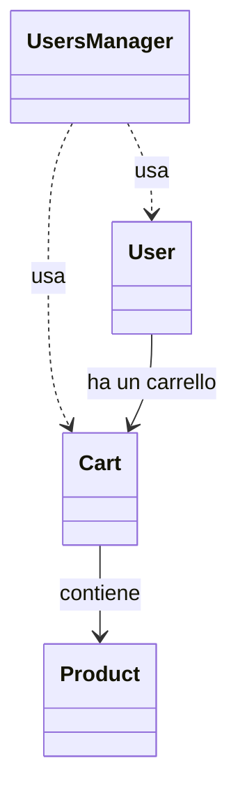

# Lab FIS 1
*Fabio Nicolosi: s759267* \
*Enrico Ulivi: s6199535*

<br></br>
---

## Problemi rilevati da Sonar

<br></br>

### *User.java*


---
#### Codice 
```java
public boolean isActive(){
    if(accountActive)
        return true;
    return false;
}
```

#### Problema rilevato
    Replace this if-then-else statement by a single return statement.

#### Soluzione proposta
```java
public boolean isActive(){
    return isAccountActive();
}
```

---
<br></br>

#### Codice 
```java
public boolean deactivateAccount(String id) {
        if (accountActive && this.userID == id) {
            accountActive = false;
            return true;
        }
        return false;
    }

public boolean isEquals(User u){
    return Objects.equals(u.userID, this.userID);
}

```

#### Problema rilevato
    Strings and Boxed types should be compared using "equals()".

#### Soluzione proposta
```java


public boolean deactivateAccount(String id) {
    if (accountActive && this.userID.equals(id)) {
        accountActive = false;
        return true;
    }
    return false;
}

public boolean isEquals(User u){
    return Objects.equals(u.userID, this.userID);
}


```

---
<br></br>

#### Codice 
```java
public void printUserInfo() {
    System.out.println("User Info: " + firstname + " " + lastname + " (Username: " + username + ")");
}

```

#### Problema rilevato
    Replace this use of System.out by a logger.

#### Soluzione proposta
```java
public void printUserInfo() {
    LOGGER.info(() -> String.format("User Info: %s %s (Username: %s)", firstname, lastname, username));
}
```

---
<br></br>

#### Codice 
```java
public void linkCart(Cart cart) throws Exception{
    if(cart == null)
        throw new Exception();
    this.cart = cart;
}
```

#### Problema rilevato
    Replace this use of System.out by a logger.

#### Soluzione proposta
```java
public void linkCart(Cart cart) {
    if (cart == null)
        throw new IllegalArgumentException("Cart cannot be null");
    this.cart = cart;
}
```

<br></br>


#### Codice 
```java
public void PrintEveryRole(){
    for (int i = roles.length; i > 0; i++){
        System.out.println(roles[i]);
    }
}
```

#### Problema rilevato
    Rename this method name to match the regular expression '^[a-z][a-zA-Z0-9]*$'.

#### Soluzione proposta
```java
public void printEveryRole(){
    for (int i = roles.length - 1; i >= 0; i--){
        System.out.println(roles[i]);
    }
}

```

---
<br></br>

### *UserManager.java*

---
#### Codice 
```java
public final static String basicUserID = "User00-";
public final static List<User> users = new ArrayList<User>();

```

#### Problema rilevato
    Rename this constant name to match the regular expression '^[A-Z][A-Z0-9]*(_[A-Z0-9]+)*$'.
    Reorder the modifiers to comply with the Java Language Specification.

#### Soluzione proposta
```java
public static final String BASIC_USER_ID = "User00-";
public static final List<User> users = new ArrayList<User>();
```

---
<br></br>

#### Codice 
```java
public boolean findUserFromDB(String userID) throws SQLException {
    try (Connection conn = DriverManager.getConnection("jdbc:mysql://localhost:3306/mydatabase", BASIC_USER_ID+userID, "password");) {
        String query = "select firstname, lastname " + "from USERS where username="+ (BASIC_USER_ID+userID);
        PreparedStatement stmt = conn.prepareStatement(query);
        ResultSet rs = stmt.executeQuery();
        while (rs.next())
            if(rs != null)
                return true;
        return false;

    } catch (SQLException e) {
        return false;
    }
}

```

#### Problema rilevato
    Use try-with-resources or close this "PreparedStatement" in a "finally" clause.
    Remove this expression which always evaluates to "true" [+2 locations]

#### Soluzione proposta
```java
public boolean findUserFromDB(String userID) throws SQLException {
    try (Connection conn = DriverManager.getConnection("jdbc:mysql://localhost:3306/mydatabase", BASIC_USER_ID+userID, "password");) {
        String query = "select firstname, lastname from USERS where username = ?";
        try (PreparedStatement stmt = conn.prepareStatement(query)) {
            stmt.setString(1, BASIC_USER_ID + userID);
            try (ResultSet rs = stmt.executeQuery()) {
                return rs.next();
            }
        }

    } catch (SQLException e) {
        return false;
    }
}
```

---
<br></br>

#### Codice 
```java
void removeEmptyTitlesFromUser(User user) {      
    List<String> titles = user.getTitles();
    for (int i = 0; i < titles.size(); i++) {
        if (titles.get(i).isEmpty()) {
        titles.remove(i); 
        }
    }
}
```

#### Problema rilevato
    Verify that "remove()" is used correctly.

#### Soluzione proposta
```java
void removeEmptyTitlesFromUser(User user) {      
    List<String> titles = user.getTitles();
    int i;
    for (i = 0; i < titles.size(); i++) {
        if (titles.get(i).isEmpty()) {
            titles.remove(i);
            i--;
        }
    }
}
```

---
<br></br>


#### Codice 
```java
void addCartToUser(User user, Cart cart) throws Exception{
    try {
        user.linkCart(cart);
    } catch (Exception e) {
        throw e;
    }
}
```

#### Problema rilevato
    Add logic to this catch clause or eliminate it and rethrow the exception automatically.

#### Soluzione proposta
```java
void addCartToUser(User user, Cart cart) throws Exception{
    user.linkCart(cart);
}
```

---
<br></br>
## DesigniteJava

Ho eseguito DesigniteJava da riga di comando sul progetto `Lab2_FIS` (dopo aver applicato le correzioni di SonarQube) e poi ho analizzato i file CSV generati nella cartella di output.

### a. Metodi con complessità ciclomatica più alta

Aprendo `MethodMetrics.csv` e guardando la colonna `CC`, ho visto che il valore massimo è 3, raggiunto da due metodi:

| Metodo | Classe | CC | LOC |
|---|---|---|---|
| `updateProductQuantity` | `Cart` | 3 | 4 |
| `removeEmptyTitlesFromUser` | `UsersManager` | 3 | 10 |

Tutti gli altri metodi hanno CC 1 o 2, quindi nel progetto non ci sono metodi molto complessi.

### b. Code smell in `User` e `UsersManager`

Dai file `DesignSmells.csv` e `ImplementationSmells.csv` risultano questi smell:

| Classe | Elemento | Smell | Tipo | Perché è un problema | Effetti su manutenibilità e leggibilità |
|---|---|---|---|---|---|
| `User` | Costruttore `User` (7 parametri) | Long Parameter List | Implementation | Il metodo richiede troppi valori, molti dello stesso tipo, e l'ordine è facile da sbagliare. | Chiamate difficili da leggere, errori di ordine non rilevati dal compilatore, modifiche dolorose se si aggiunge un campo. |
| `UsersManager` | `findUserFromDB` (istruzione di 126 caratteri) | Long Statement | Implementation | Una sola riga concentra URL, utente e password della connessione. | Riga difficile da leggere e modificare, dati di configurazione nascosti nel codice. |
| `UsersManager` | Campi `BASIC_USER_ID` e `users` | Deficient Encapsulation | Design | I campi sono pubblici, soprattutto `users`, che è una lista statica e mutabile. | Qualunque classe può modificare lo stato senza passare dai metodi, nessuna invariante garantita, forte accoppiamento. |
| `UsersManager` | Intera classe | Unutilized Abstraction | Design | Nessuna classe del progetto usa `UsersManager` (Fan-In = 0 in `TypeMetrics.csv`). | Codice morto o incompleto che confonde chi legge e va comunque mantenuto. |

Leggendo il codice ho notato anche due problemi che il tool non segnala: un magic number (il `5` in `new String[5]` in `User`) e dei metodi duplicati (`setUsername` e `updateUsername`, `isActive` e `isAccountActive`).

### c. `UsersManager` e i principi di buon design

Secondo me `UsersManager` viola diversi principi:

- **Incapsulamento e coesione:** `users` è pubblico e statico, e in `TypeMetrics.csv` la LCOM della classe è 0.75, contro 0.0 di `Cart` e `Product` e 0.11 di `User`. Questo indica bassa coesione.
- **Single Responsibility:** la classe accede al database con JDBC, gestisce la lista utenti in memoria e modifica dati di `User` (`removeEmptyTitlesFromUser`, `addCartToUser`).
- **Dependency Inversion:** dipende direttamente da `DriverManager` e da URL e credenziali scritti nel codice, senza interfacce. Cambiare database o testare la classe è difficile.
- **Tell, Don't Ask:** `removeEmptyTitlesFromUser` modifica dall'esterno la lista dei titoli di `User`, mentre questa logica dovrebbe stare in `User`.

### d. Problemi di architettura

`ArchitectureSmells.csv` contiene solo l'intestazione, quindi DesigniteJava non ha rilevato smell architetturali. Il progetto è comunque molto piccolo (2 package e 4 classi). Leggendo il codice vedo questi problemi:

- **Nessuna separazione a livelli:** accesso al database, logica di dominio e dati stanno nello stesso package, senza uno strato di persistenza.
- **Stato globale condiviso:** la lista statica pubblica `users` fa da "database in memoria". `addUser` controlla l'esistenza sul database ma scrive nella lista, quindi le due fonti possono diventare incoerenti.
- **Configurazione nel codice:** URL, utente e password del database sono scritti nelle classi.
- **Dipendenze tra package:** `user` dipende da `cart` (`User` e `UsersManager` usano `Cart`) e non ci sono cicli, quindi è un aspetto positivo.
- **Nessun test:** nell'analisi non risultano classi di test (`IsTest = 0` per tutti i metodi).

## Class Visualizer

Non è stato possibile scaricare Class Visualizer, quindi gli screenshot dei pannelli *Relations Diagram* e *Preview* non sono disponibili. Le relazioni tra le classi sono state ricavate dall'analisi del codice e dalle metriche Fan-In e Fan-Out di DesigniteJava (`TypeMetrics.csv`).

### Relazioni tra le classi



- **User** usa `Cart` (campo, metodi `linkCart` e `getCart`) ed è usata da `UsersManager`.
- **UsersManager** usa `User` (lista `users`, metodi `addUser` e `removeEmptyTitlesFromUser`) e `Cart` (metodo `addCartToUser`). Nessuna classe del progetto la usa.
- **Cart** usa `Product` (mappa dei prodotti, `calculateTotal`) ed è usata da `User` e `UsersManager`.
- **Product** non usa altre classi del progetto ed è usata da `Cart`.

### Associazioni Uses e Used By

| Classe | Uses (Fan-Out) | Used By (Fan-In) |
|---|---|---|
| `User` | 1 (`Cart`) | 1 (`UsersManager`) |
| `UsersManager` | 2 (`User`, `Cart`) | 0 |
| `Cart` | 1 (`Product`) | 2 (`User`, `UsersManager`) |
| `Product` | 0 | 1 (`Cart`) |

I conteggi considerano solo le classi del progetto: Class Visualizer potrebbe contare anche classi esterne (come quelle di `java.util`), quindi i suoi numeri potrebbero essere più alti